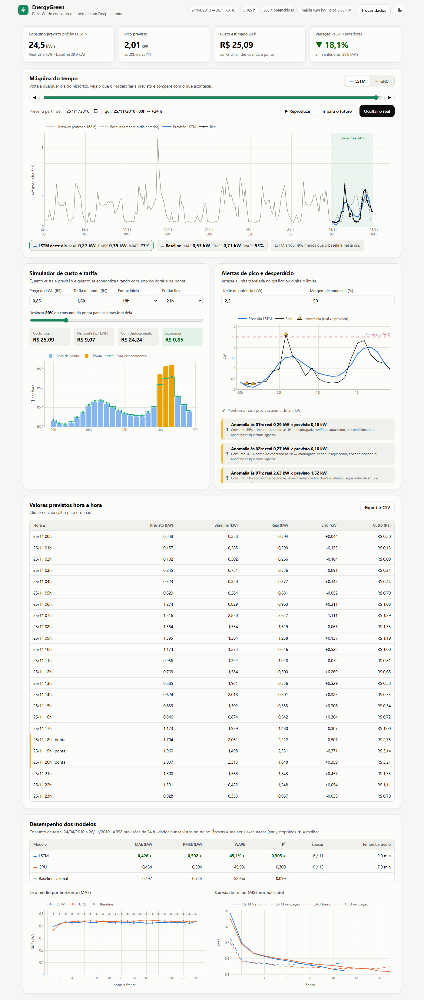
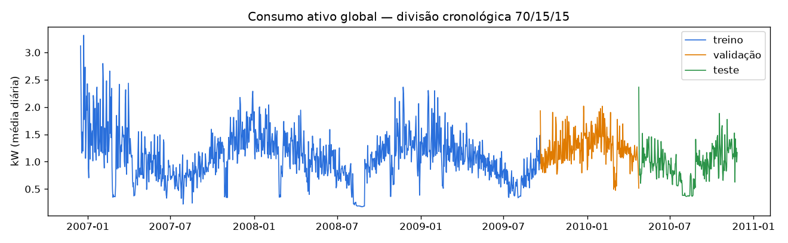
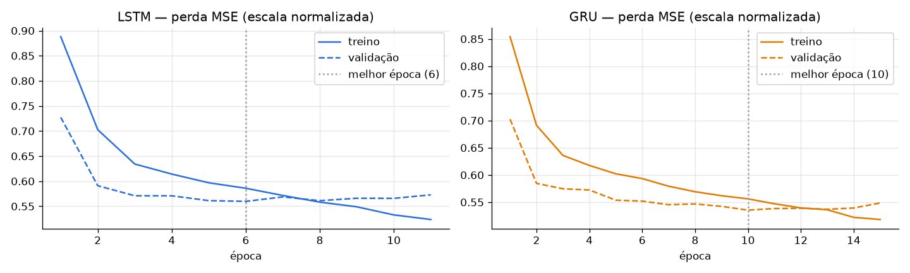
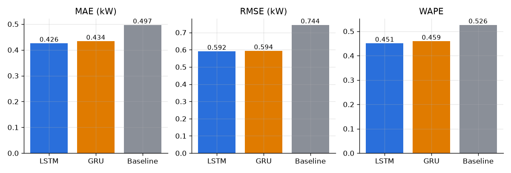
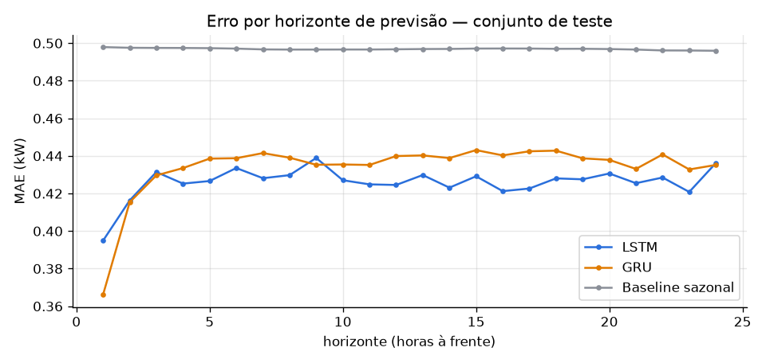
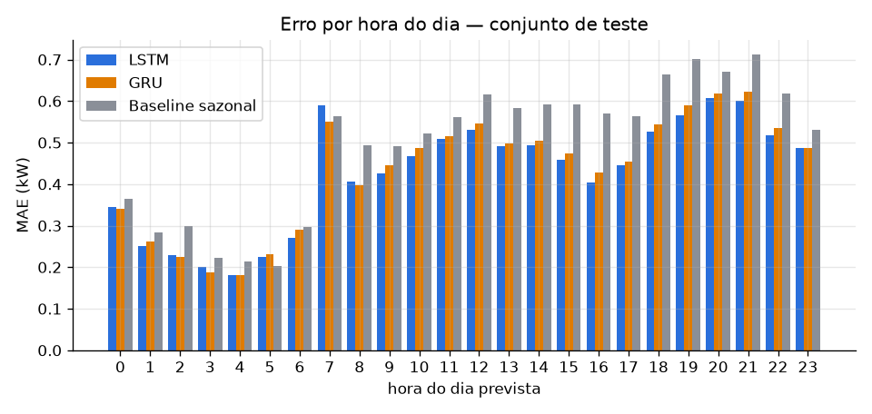
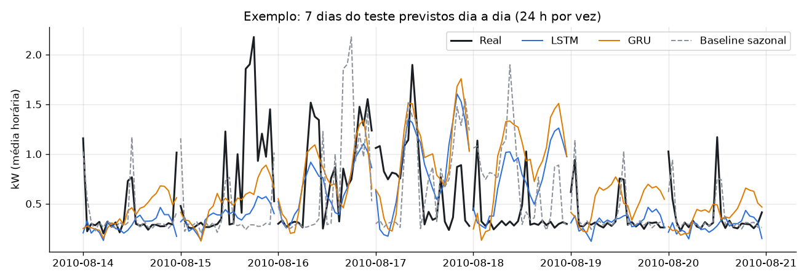
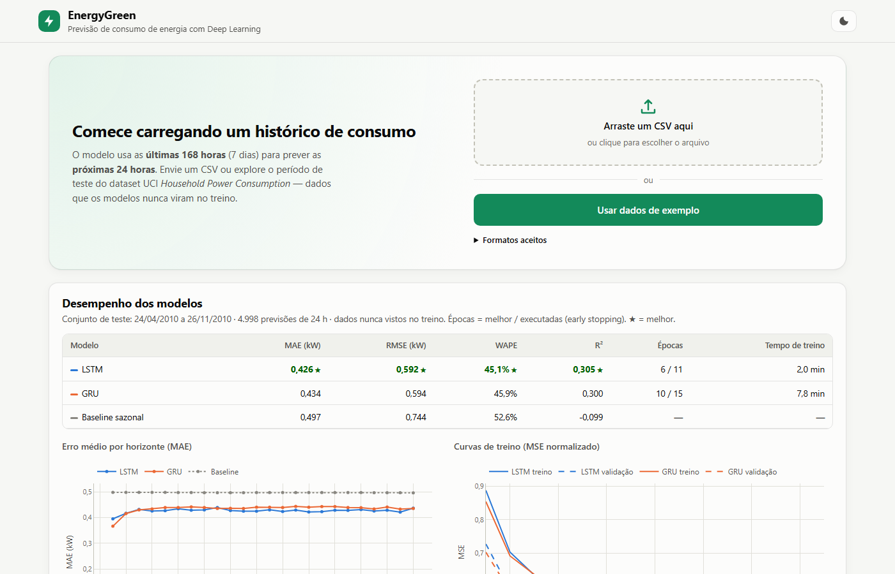
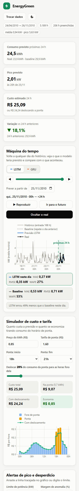
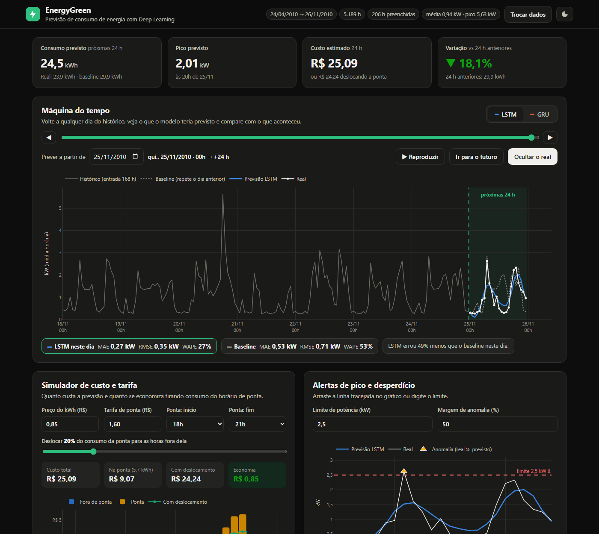

# EnergyGreen — Previsão de Consumo de Energia com Deep Learning

Trabalho acadêmico (CASE 3). Prevê as **próximas 24 horas** de consumo elétrico de uma residência a partir
das **últimas 168 horas** (7 dias), com redes recorrentes **LSTM** e **GRU** em PyTorch, comparadas a um
baseline sazonal. Inclui uma aplicação web (FastAPI + dashboard próprio) com máquina do tempo, simulador de
tarifa e alertas de pico.



> Todos os números deste documento saíram de execuções reais (`python -m src.data`, `python -m src.train`,
> `python -m src.evaluate`) e coincidem com `models/metrics.json`. Ambiente: Windows 11, Python 3.14.7,
> PyTorch 2.15.0 em CPU (sem GPU).

---

## 1. Contextualização do problema

Uma empresa quer prever o consumo de energia para **reduzir desperdícios** e **planejar a operação**:
contratar demanda, deslocar cargas para fora do horário de ponta (quando a tarifa é mais cara) e detectar
consumo anômalo. Consumo elétrico é uma série temporal com padrões fortes — ciclo diário, diferença entre
dias úteis e fins de semana, sazonalidade anual — mas também com muito ruído: um forno ou um aquecedor ligado
fora de hora cria picos que nenhum histórico antecipa.

## 2. Objetivo da solução

1. Estruturar a série temporal de consumo para aprendizado supervisionado, **sem vazamento de dados**.
2. Treinar e validar duas redes recorrentes (LSTM e GRU) que prevejam as 24 h seguintes de uma só vez.
3. Medir o ganho real sobre um baseline ingênuo e interpretar criticamente onde o modelo erra.
4. Entregar uma aplicação que **recebe dados históricos** (CSV ou exemplo), **executa a previsão**,
   **exibe os valores previstos** e **apresenta gráficos comparativos** — e que transforme a previsão em
   decisões (custo, deslocamento de carga, alertas).

## 3. Dados: origem e organização

**Individual Household Electric Power Consumption** — UCI Machine Learning Repository, id 235
(<https://archive.ics.uci.edu/dataset/235>). Uma residência em Sceaux (França), medições a cada minuto.
O download é feito por script (`src/data.py`) a partir de
`https://archive.ics.uci.edu/static/public/235/individual+household+electric+power+consumption.zip`
(URL verificada: 20,6 MB, contém `household_power_consumption.txt`). A pasta `data/` não é versionada.

Valores observados na execução real:

| Item | Valor |
|---|---|
| Linhas (minutos) | 2.075.259 |
| Período | 16/12/2006 17:24 → 26/11/2010 21:02 |
| Minutos sem medição (`?`) | 25.979 (1,25%) |
| Série horária (após reamostragem) | 34.589 horas |
| Horas sem nenhuma medição (preenchidas) | 421 |
| Consumo horário médio / mediano / máximo | 1,089 / 0,800 / 6,561 kW |

Organização do arquivo: separador `;`, datas `dd/mm/aaaa`, faltantes marcados com `?`.

| Coluna | Significado |
|---|---|
| `Date`, `Time` | data e hora da medição |
| `Global_active_power` | potência ativa média no minuto (kW) — **alvo** |
| `Global_reactive_power` | potência reativa (kW) |
| `Voltage` | tensão (V) |
| `Global_intensity` | corrente (A) |
| `Sub_metering_1` | energia da cozinha (Wh) |
| `Sub_metering_2` | energia da lavanderia (Wh) |
| `Sub_metering_3` | energia do aquecedor de água e ar-condicionado (Wh) |

A análise exploratória (no notebook) mostra autocorrelação de 0,713 em 1 h, 0,436 em 24 h e 0,466 em
168 h — o padrão semanal é tão forte quanto o diário, o que justifica a janela de 7 dias. A distribuição é
assimétrica (assimetria 1,30; p99 = 3,92 kW): a maior parte do tempo o consumo é baixo, com picos curtos.

## 4. Estruturação da série temporal (resposta à "Pergunta" do case)

*"Como você estruturaria séries temporais e aplicaria Deep Learning para prever consumo futuro?"*

1. **Limpeza** — `Date`+`Time` viram um índice datetime; `?` vira NaN; colunas numéricas.
2. **Reamostragem horária** — média por hora (34.589 pontos). Reduz o ruído minuto a minuto, deixa o
   problema no horizonte de decisão (planejamento horário/diário) e viabiliza o treino em CPU.
3. **Faltantes** — lacunas de até 6 h são interpoladas no tempo; lacunas longas recebem o valor da **mesma
   hora da semana anterior** (preserva o padrão diário/semanal em vez de criar uma reta artificial).
4. **Features** (12): as 7 medições + seno/cosseno da hora do dia + seno/cosseno do dia da semana + flag de
   fim de semana. A codificação cíclica diz à rede que 23h e 0h são vizinhas.
5. **Divisão cronológica** 70/15/15, sem embaralhar:

   | Conjunto | Período | Horas |
   |---|---|---|
   | Treino | 16/12/2006 17h → 20/09/2009 12h | 24.212 |
   | Validação | 20/09/2009 13h → 24/04/2010 16h | 5.188 |
   | Teste | 24/04/2010 17h → 26/11/2010 21h | 5.189 |

6. **Normalização** — `StandardScaler` ajustado **somente no treino** e aplicado a validação/teste; o alvo é
   desnormalizado antes de qualquer métrica.
7. **Janelas deslizantes** — cada exemplo é X = 168 h × 12 features → y = 24 h seguintes de
   `Global_active_power`. As janelas são criadas **dentro** de cada divisão, então nenhuma janela de teste
   enxerga dados de treino ou validação (nem na entrada, nem no alvo). Formas reais:
   treino (4.805, 168, 12), validação (4.997, 168, 12), teste (4.998, 168, 12).

A ausência de vazamento é verificada por testes automatizados (`tests/test_data.py`) e por asserções no notebook.



## 5. Arquitetura / modelagem

| Modelo | Descrição | Parâmetros |
|---|---|---|
| **Baseline sazonal ingênuo** | as próximas 24 h repetem as últimas 24 h observadas | 0 |
| **LSTMForecaster** | 2 camadas LSTM de 64 unidades, dropout 0,2 → último estado oculto → `Linear(64, 24)` | 54.808 |
| **GRUForecaster** | 2 camadas GRU de 64 unidades, dropout 0,2 → último estado oculto → `Linear(64, 24)` | 41.496 |

A saída é **multi-passo direta**: as 24 horas saem de uma só vez, sem realimentar previsões (o erro não se
acumula de um passo para o seguinte). Os hiperparâmetros ficam centralizados na dataclass `Config`
(`src/models.py`) e são salvos junto com os pesos e em `metrics.json`.

## 6. Processo de treinamento

- Adam (lr 1e-3), perda MSE na escala normalizada, lote 64, até 30 épocas, semente 42 (`random`, `numpy`, `torch`).
- *Early stopping* com paciência 5 na perda de validação, **restaurando os melhores pesos**.
- `ReduceLROnPlateau` (fator 0,5, paciência 2). Gradientes limitados (norma 1,0).
- Lotes de treino embaralhados (as janelas são independentes entre si); validação e teste em ordem.
- **Passo 5 entre janelas de treino** (validação e teste usam todas as janelas). Ver *Desvios* abaixo.

| Modelo | Épocas executadas | Melhor época | Melhor perda de validação (MSE) | Tempo |
|---|---|---|---|---|
| LSTM | 11 | 6 | 0,5597 | 2,0 min |
| GRU | 15 | 10 | 0,5354 | 7,8 min |

O early stopping atuou nos dois modelos. A perda de treino continua caindo enquanto a de validação estabiliza
— sinal de início de sobreajuste, contido pela restauração dos melhores pesos.



## 7. Métricas utilizadas (e por que essas)

Todas no conjunto de teste, em **kW** (escala original), sobre as 4.998 janelas de teste:

- **MAE** — erro médio absoluto em kW; fácil de explicar ("erramos, em média, X kW por hora").
- **RMSE** — penaliza mais os erros grandes; importa porque errar um pico custa caro (demanda, ponta).
- **WAPE** = Σ|erro| / Σ|real| — erro relativo agregado, estável mesmo com consumo baixo.
- **R²** — fração da variância explicada; compara com "prever sempre a média".
- **Sem MAPE, de propósito.** O MAPE divide cada erro pelo consumo daquela hora. Nas madrugadas o consumo
  fica perto do mínimo (10% das horas do teste estão abaixo de 0,3 kW; o mínimo horário é 0,195 kW), e um erro
  pequeno em kW vira um erro percentual enorme. A métrica passa a medir o denominador, não o modelo. Só para
  ilustrar: o MAPE da LSTM daria 59,0% e o do baseline 65,1%, números dominados por essas horas de baixo
  consumo. O WAPE responde à mesma pergunta ("quanto erramos em proporção?") sem esse defeito. Com dados por
  minuto, em que o consumo chega a zero, o MAPE nem seria definido.

Extras: erro por horizonte (h+1 … h+24), erro por hora do dia e curvas de treino/validação.

## 8. Resultados obtidos

| Modelo | MAE (kW) | RMSE (kW) | WAPE | R² |
|---|---|---|---|---|
| **LSTM** | **0,4260** | **0,5916** | **45,1%** | **0,305** |
| GRU | 0,4339 | 0,5940 | 45,9% | 0,300 |
| Baseline sazonal | 0,4969 | 0,7441 | 52,6% | −0,099 |

- A **LSTM reduz o MAE em 14,3%** e o RMSE em 20,5% em relação ao baseline; a **GRU**, em 12,7% e 20,2%.
- O baseline tem R² negativo: repetir o dia anterior é pior do que prever a média, porque os picos
  de um dia raramente se repetem no mesmo horário do dia seguinte.
- Previsão a previsão (as 208 previsões feitas à meia-noite no teste), a LSTM erra menos que o baseline em
  **139 dias (67%)** e a GRU em **137 (66%)** — nos outros dias o baseline vence.



**Erro por horizonte** — o MAE das redes cresce pouco com a distância: LSTM 0,395 kW em h+1 e 0,436 kW em h+24;
GRU 0,366 → 0,435 kW. O baseline fica em ~0,497 kW em todos os passos (ele não usa a informação recente).



**Erro por hora do dia** — o erro é mínimo na madrugada (LSTM 0,180 kW às 4h) e máximo no início da noite
(LSTM 0,606 kW às 20h; GRU 0,623 kW às 21h; baseline 0,712 kW às 21h). A LSTM supera o baseline em 22 das 24
horas do dia; perde às 5h e às 7h, quando o consumo matinal começa em horários que variam de um dia para o outro.





## 9. Análise crítica

**Onde o modelo erra: picos.** Nas horas em que o consumo real ficou acima do percentil 90 do teste
(1,92 kW), o MAE da LSTM é 1,026 kW, contra 0,359 kW no restante, e o viés é de −1,007 kW: **o modelo
subestima sistematicamente os picos**. A GRU erra um pouco menos nos picos (0,935 kW; viés −0,898) e o
baseline quase o mesmo (1,065 kW). As redes aprendem o *formato médio* do dia e suavizam a curva: o desvio
padrão das previsões da LSTM é 0,505 kW, contra 0,710 kW do consumo real. É o comportamento esperado de um
modelo treinado com MSE diante de picos de horário imprevisível (alguém liga o forno às 19h10 ou às 20h40).
O exemplo acima mostra isso: o nível e o ritmo do dia são acertados, os picos isolados não.

**Horizontes longos.** O erro sobe de h+1 para h+6 e depois estabiliza. A primeira hora se beneficia da
inércia do consumo (autocorrelação de 0,71 em 1 h); a partir de algumas horas, a previsão depende só do padrão
diário/semanal aprendido. Por ser multi-passo direto, não há acúmulo de erro ao longo do horizonte.

**Comparação com o baseline.** O ganho é real, mas moderado (14% em MAE, 20% em RMSE), e o baseline vence em
cerca de um terço dos dias. O ganho maior em RMSE indica que as redes evitam os erros grandes do baseline —
que "copia" picos do dia anterior para horários em que eles não acontecem. A LSTM e a GRU ficaram
praticamente empatadas; a LSTM leva vantagem pequena em MAE/RMSE e a GRU nos picos. Um R² de 0,30 é coerente
com a natureza do problema: uma única casa tem consumo muito mais errático do que um agregado de milhares
de consumidores.

**Limitações.**
- **Uma única residência**: o modelo não generaliza para outros perfis sem novo treino.
- **Sem variáveis exógenas**: nada de temperatura, feriados, férias ou ocupação, que explicam boa parte
  dos picos e das quedas (ex.: a queda de consumo em agosto, visível na sazonalidade mensal do notebook,
  provavelmente ligada a férias).
- **Dados de 2006–2010**: hábitos e equipamentos mudaram.
- **Mudança de distribuição**: o teste (abril–novembro de 2010) tem consumo médio de 0,943 kW, contra 1,086 kW
  no treino e 1,249 kW na validação (outono/inverno). Teste e validação cobrem estações diferentes.
- **Treino com passo 5** entre janelas (para caber em minutos na CPU): usa ~1/5 das janelas possíveis.
- Upload só com o consumo: as demais medições são estimadas a partir do treino, o que pode degradar a previsão.

**Melhorias possíveis.** Incluir temperatura e calendário de feriados; treinar com todas as janelas (passo 1)
em GPU; perda quantílica para prever intervalos (p10–p90) em vez de um valor só, o que é mais útil para
alertas de pico; arquiteturas com atenção (TCN, Transformer temporal) e busca de hiperparâmetros; validação
*walk-forward* com várias origens; e, para uso real, retreino periódico com dados recentes.

## 10. A aplicação

FastAPI serve a API (`/api/*`) e o dashboard (`app/static/`, HTML/CSS/JS puro, Plotly.js 3.0.1 via cdnjs).
Interface em português, responsiva, com tema claro/escuro.

| Tela inicial | Celular | Tema escuro |
|---|---|---|
|  |  |  |

**Como usar**

1. **Entrada de dados** — arraste um CSV para a área indicada ou clique em **"Usar dados de exemplo"** (o
   período de teste, que os modelos nunca viram). Formatos aceitos: bruto UCI (`;`, `Date`, `Time`,
   `Global_active_power`, …) ou horário (`datetime` + `Global_active_power`, demais colunas opcionais).
   Mínimo de 168 h. O cabeçalho mostra período, horas, horas preenchidas e medições estimadas.
2. **Cartões** — consumo previsto (kWh), pico previsto e horário, custo estimado e variação contra as 24 h
   anteriores. Reagem a toda interação.
3. **Máquina do tempo** — escolha um dia pelo controle deslizante, pelo seletor de data ou pelas setas ◀ ▶
   (também pelo teclado ← →). O gráfico mostra as 168 h de entrada e a previsão das 24 h seguintes, com o
   baseline sempre visível. **"Revelar o real"** sobrepõe o que aconteceu e mostra MAE/RMSE/WAPE do dia contra
   o baseline. **"Reproduzir"** avança dia a dia; **"Ir para o futuro"** prevê as 24 h após o fim da série.
   Alterne entre **LSTM** e **GRU**.
4. **Simulador de custo e tarifa** — preço do kWh, tarifa de ponta, faixa de ponta e o controle "deslocar X%
   do consumo da ponta". Custo por hora (barras, ponta destacada), total e economia recalculam ao vivo.
5. **Alertas de pico e desperdício** — **arraste a linha tracejada** no gráfico (ou digite o limite) para
   listar as horas previstas acima dele. Com o real revelado, horas em que o consumo real superou o previsto
   além da margem aparecem como anomalias, com sugestão de ação.
6. **Tabela hora a hora** — previsto, baseline, real, erro e custo; ordenável; **Exportar CSV** (separador
   `;` e vírgula decimal, abre direto no Excel em português).
7. **Desempenho dos modelos** — métricas de teste, erro por horizonte e curvas de treino.

**API** (contrato completo em [docs/API.md](docs/API.md)): `POST /api/upload`, `GET /api/exemplo`,
`GET /api/serie`, `POST /api/prever`, `POST /api/custo`, `POST /api/alertas`, `GET /api/desempenho`.
Erros sempre em `{"detail": "mensagem em português"}`; 503 se os modelos não estiverem treinados.

## 11. Como reproduzir

```powershell
python -m venv .venv
.\.venv\Scripts\Activate.ps1
pip install torch==2.15.0 --index-url https://download.pytorch.org/whl/cpu
pip install -r requirements.txt

python -m src.data        # baixa (~20 MB) e prepara os dados; imprime o resumo
python -m src.train       # treina LSTM e GRU (~10 min em CPU de 4 núcleos lógicos)
python -m src.evaluate    # métricas de teste + figuras em reports/figures/
pytest                    # 32 testes
jupyter nbconvert --to notebook --execute --inplace notebooks/experimento.ipynb   # reexecuta o notebook

uvicorn app.main:app      # dashboard em http://localhost:8000
```

Estrutura:

```
src/data.py       download, limpeza, reamostragem, features, divisão, janelas, leitura de CSV do usuário
src/models.py     Config, LSTMForecaster, GRUForecaster, baseline sazonal
src/train.py      treino com early stopping → models/lstm.pt, gru.pt, scaler.pkl, metrics.json
src/evaluate.py   métricas, erro por horizonte/hora, análise de picos, figuras
src/predict.py    Previsor: carrega artefatos e prevê a partir de um histórico horário
app/main.py       API FastAPI + arquivos estáticos
app/services.py   regras de custo/tarifa e alertas (funções puras)
app/static/       dashboard (index.html, styles.css, app.js)
tests/            testes de dados, serviços e endpoints
notebooks/experimento.ipynb   experimento executado, com saídas
```

### Desvios em relação ao plano (e por quê)

- **Passo 5 entre janelas de treino.** Nesta máquina (4 núcleos lógicos, sem GPU), uma época com todas as
  24.021 janelas levou ~50 s na LSTM e ~125 s na GRU; 30 épocas levariam mais de uma hora. Com passo 5 o treino
  completo levou ~10 min. O passo 5 foi escolhido por ser coprimo de 24: as janelas continuam começando em
  todas as horas do dia. Validação e teste usam todas as janelas (passo 1).
- **Upload só com o consumo.** Os modelos usam as 7 medições; se o CSV horário trouxer só
  `Global_active_power`, a corrente é estimada por uma relação linear ajustada no treino e as demais
  medições recebem a média do treino. A resposta de `/api/upload` ganha o campo extra `colunas_estimadas`
  (o dashboard avisa quando isso acontece).
- **Notebook não retreina.** Ele reutiliza `src/`, carrega os pesos e o histórico de `models/` e recalcula as
  métricas de teste (com asserção de que batem com `metrics.json`). `RETREINAR = True` treina de novo.
- **Campos extras (aditivos) na API:** `/api/prever` devolve em `metricas` também as do baseline no mesmo dia e
  `horas_com_real`; `/api/custo` devolve `ponta`, `kwh_deslocado` e `custo_hora_deslocado` (usados no gráfico).
- **Faixa de ponta semiaberta:** `ponta_inicio=18, ponta_fim=21` cobre 18h, 19h e 20h (três horas, como na
  tarifa branca); faixas que cruzam a meia-noite são aceitas.
- **Linha de limite arrastável** implementada com *pointer events* sobre o gráfico Plotly (em vez da edição de
  shapes do Plotly), para restringir o arraste ao eixo vertical e arredondar para 0,1 kW.
- **Plotly.js 3.0.1** (a versão 2.35.2 não está no cdnjs).
- `pytest.ini` com `pythonpath = .` para o comando `pytest` funcionar a partir da raiz.
