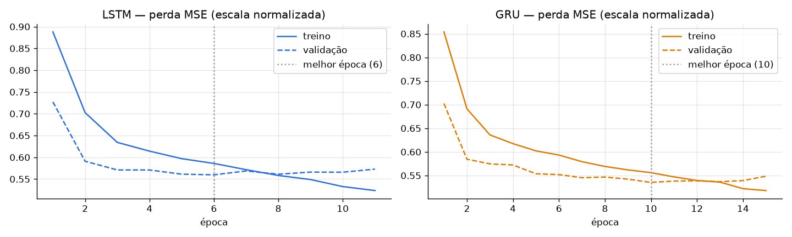

# 3. A curva de Loss foi feita e implementada?

**Resposta curta: sim.** A curva de loss (perda) é registrada em cada época, salva em arquivo,
desenhada como gráfico e mostrada no dashboard.

---

## O que é a curva de loss

A **loss** (perda) é o número que mede o quanto a rede está errando. Quanto menor, melhor.
A **curva de loss** mostra esse número época após época. Desenhamos **duas** curvas para cada
modelo:

- **Loss de treino**: o erro nos dados que a rede usa para aprender.
- **Loss de validação**: o erro em dados que a rede **não** usa para aprender.

Comparar as duas é o que permite ver se o modelo está aprendendo de verdade ou só decorando
(ver o arquivo 5, sobre overfitting).

## Onde está implementada

| Onde | O que faz |
|---|---|
| [src/train.py](../../src/train.py) | Calcula a loss de treino e de validação a cada época e guarda as duas listas |
| `models/metrics.json` | Arquivo onde o histórico fica salvo (`perda_treino` e `perda_validacao`) |
| [src/evaluate.py](../../src/evaluate.py) | Desenha o gráfico e salva em `reports/figures/curvas_perda.png` |
| `notebooks/experimento.ipynb` | Mostra o gráfico com a análise |
| Dashboard (web) | Seção "Curvas de treino (MSE normalizado)", gráfico interativo |
| `README.md`, seção 6 | Gráfico com a explicação |

## Os números reais

A loss é o MSE na escala normalizada (por isso os valores ficam em torno de 0,5 a 0,9, e não
em kW).

**LSTM** (11 épocas):

| Época | 1 | 2 | 3 | 4 | 5 | **6** | 7 | 8 | 9 | 10 | 11 |
|---|---|---|---|---|---|---|---|---|---|---|---|
| Treino | 0,888 | 0,703 | 0,634 | 0,614 | 0,597 | **0,586** | 0,572 | 0,558 | 0,549 | 0,533 | 0,524 |
| Validação | 0,727 | 0,591 | 0,571 | 0,571 | 0,561 | **0,560** | 0,569 | 0,561 | 0,566 | 0,566 | 0,573 |

**GRU** (15 épocas): melhor validação na época **10** (0,535); última época com 0,549.

## Como ler o gráfico

1. **No início, as duas curvas caem juntas.** A rede está aprendendo padrões reais (ciclo do
   dia, diferença entre semana e fim de semana).
2. **Depois, a de treino continua caindo, mas a de validação para e começa a subir.** É o sinal
   de que a rede começou a decorar os dados de treino em vez de aprender o padrão geral.
3. **O ponto mais baixo da validação é o melhor modelo.** Foi esse que salvamos: época 6 na
   LSTM e época 10 na GRU (linha pontilhada vertical no gráfico).
