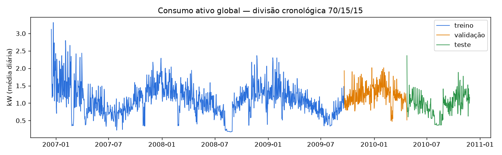

# 7. Qual o dataset utilizado?

**Resposta curta:** o **Individual Household Electric Power Consumption**, do repositório
**UCI Machine Learning Repository** (id 235). São medições de consumo de energia de **uma casa**
na França, **minuto a minuto**, por quase **4 anos**.

- Página oficial: <https://archive.ics.uci.edu/dataset/235>
- Download feito automaticamente pelo script `python -m src.data` (arquivo de 20,6 MB).

---

## Visão geral

| Item | Valor |
|---|---|
| Local | Uma residência em Sceaux, perto de Paris (França) |
| Período | 16/12/2006 até 26/11/2010 |
| Frequência | uma medição por minuto |
| Total de linhas | 2.075.259 |
| Minutos sem medição | 25.979 (1,25%), marcados com `?` |
| Depois de agregar por hora | 34.589 horas |
| Consumo médio por hora | 1,09 kW (máximo 6,56 kW) |

## As colunas

| Coluna | O que é | Uso no projeto |
|---|---|---|
| `Date`, `Time` | data e hora da medição | viram o índice de tempo |
| `Global_active_power` | potência ativa da casa (kW) | **é o que queremos prever** |
| `Global_reactive_power` | potência reativa (kW) | entrada da rede |
| `Voltage` | tensão (V) | entrada da rede |
| `Global_intensity` | corrente (A) | entrada da rede |
| `Sub_metering_1` | energia da cozinha (Wh) | entrada da rede |
| `Sub_metering_2` | energia da lavanderia (Wh) | entrada da rede |
| `Sub_metering_3` | energia do aquecedor de água e ar-condicionado (Wh) | entrada da rede |

A essas 7 medições acrescentamos 5 variáveis de calendário (hora do dia e dia da semana em
seno e cosseno, e uma marca de fim de semana), totalizando **12 variáveis de entrada**.

## Por que esse dataset

- **É público e conhecido**: qualquer pessoa pode baixar e reproduzir o trabalho.
- **É longo**: quase 4 anos permitem ver padrões diários, semanais e de estação do ano.
- **É real e "sujo" na medida certa**: tem lacunas e ruído, o que exige uma preparação de
  dados de verdade (limpeza, preenchimento), como em um projeto real.
- **Tem detalhe**: além do consumo total, traz as submedições por cômodo, que ajudam o modelo.

## Como foi dividido

A divisão segue a ordem do tempo, sem embaralhar, para o modelo nunca ver o futuro:

| Parte | Período | Horas | Uso |
|---|---|---|---|
| Treino (70%) | 16/12/2006 → 20/09/2009 | 24.212 | a rede aprende com estes dados |
| Validação (15%) | 20/09/2009 → 24/04/2010 | 5.188 | escolher a melhor época |
| Teste (15%) | 24/04/2010 → 26/11/2010 | 5.189 | nota final, dados nunca vistos |

## Limitações do dataset

- **Uma única casa**: o modelo aprende os hábitos dessa família e não serve para outra casa sem
  novo treino.
- **Sem clima nem feriados**: temperatura e férias explicam boa parte dos picos e quedas, mas
  não estão nos dados.
- **Dados antigos (2006–2010)**: os aparelhos e hábitos mudaram desde então.
