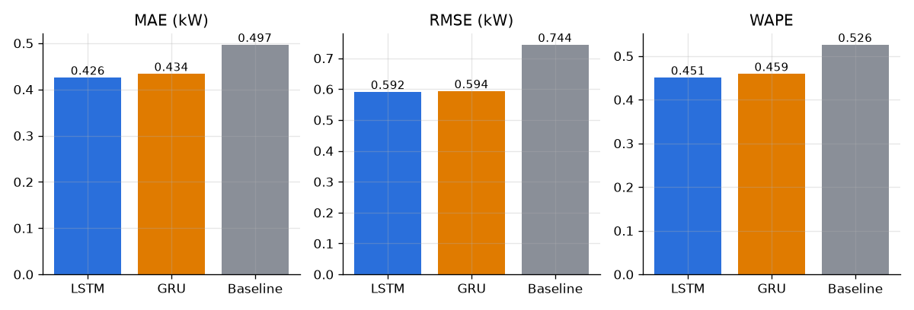
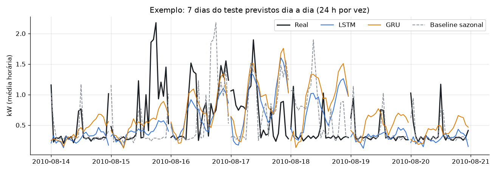

# 9. Como saber se o modelo funciona?

**Resumo:** "funcionar" tem que ser provado com números, não com impressão. Verificamos de
cinco formas, e a conclusão é: **o modelo funciona, com ganho real mas moderado**, e tem
limitações conhecidas.

---

## Prova 1: testar em dados que o modelo nunca viu

O conjunto de **teste** (abril a novembro de 2010) ficou guardado: não foi usado no treino nem
para escolher a melhor época. É como uma prova com questões inéditas. São **4.998 previsões de
24 horas**.

## Prova 2: comparar com um "chute inteligente" (baseline)

Errar 0,43 kW é bom ou ruim? Sozinho, o número não diz nada. Por isso comparamos com um
**baseline**: "amanhã vai ser igual a hoje" (repetir as últimas 24 horas). Se a rede neural
não vencer isso, ela não serve.

| Modelo | MAE (kW) | RMSE (kW) | WAPE | R² |
|---|---|---|---|---|
| **LSTM** | **0,426** | **0,592** | **45,1%** | **0,305** |
| GRU | 0,434 | 0,594 | 45,9% | 0,300 |
| Baseline | 0,497 | 0,744 | 52,6% | −0,099 |

- A LSTM erra **14,3% menos** que o baseline no erro médio (MAE).
- E **20,5% menos** no RMSE, a métrica que pune os erros grandes.
- O baseline tem R² **negativo**: é pior do que simplesmente chutar a média. A LSTM explica
  cerca de 30% da variação do consumo.



## Prova 3: ganhar no dia a dia, não só na média

Uma média pode esconder muita coisa. Olhando dia por dia (208 previsões feitas à meia-noite
no teste):

- a **LSTM venceu o baseline em 139 dias (67%)**;
- a GRU, em 137 dias (66%).

## Prova 4: entender onde ele erra

Um modelo que funciona tem erros que fazem sentido:

- **Erro por hora do dia**: o menor erro é de madrugada (0,18 kW às 4h), quando o consumo é
  estável; o maior é à noite (0,61 kW às 20h), quando as pessoas ligam aparelhos em horários
  variados. A LSTM vence o baseline em **22 das 24 horas** do dia.
- **Erro por horizonte**: prever 1 hora à frente erra 0,40 kW; 24 horas à frente, 0,44 kW. O
  erro cresce pouco, porque as 24 horas são previstas de uma só vez.
- **Picos**: é o ponto fraco. Nas horas de consumo muito alto, a LSTM **subestima** o pico (erro
  de 1,03 kW). Ela aprende o "formato médio" do dia, mas não consegue saber a que horas exata
  alguém vai ligar o forno.



## Prova 5: testes automáticos

O projeto tem **32 testes automáticos** (`pytest`), e **todos passam**. Eles verificam, entre
outras coisas:

- que **não há vazamento de dados** (nenhuma janela de teste usa dados de treino);
- que a normalização é ajustada só no treino;
- que os cálculos de custo e alertas estão corretos;
- que todos os endereços da API respondem como esperado, inclusive com erros em português.

```powershell
pytest
# 32 passed
```

## Prova 6: ver com os próprios olhos (no dashboard)

1. Abra o dashboard e clique em **"Usar dados de exemplo"**.
2. Escolha um dia na **máquina do tempo**.
3. Clique em **"Revelar o consumo real"**.
4. Compare a linha azul (previsão) com a preta (real) e leia o erro do dia ao lado do erro do
   baseline.

Navegando por vários dias, dá para ver na prática que a previsão acompanha o ritmo do dia, e
que nos picos inesperados ela fica abaixo do real.

## Conclusão honesta

| | |
|---|---|
| ✅ Funciona? | Sim: vence o baseline em todas as métricas, em dados nunca vistos |
| ✅ É confiável? | Os números são reproduzíveis (semente fixa) e verificados por testes |
| ⚠️ Ganho | Real, mas moderado (14% no MAE); o baseline ainda vence em 1 a cada 3 dias |
| ⚠️ Ponto fraco | Subestima os picos de consumo |
| 💡 Como melhorar | Incluir temperatura e feriados, treinar com mais dados e prever faixas (mínimo e máximo) em vez de um único valor |

Um R² de 0,30 é coerente com o problema: o consumo de **uma única casa** é muito mais
imprevisível do que o de uma cidade inteira.
